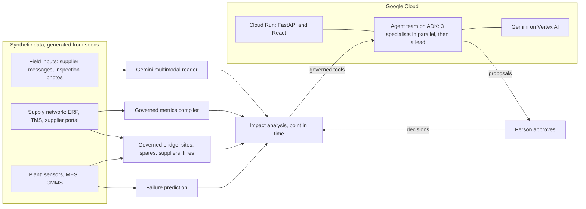

# OSI (Opsight Intelligence): submission write-up

AI Builder Cup 2026, Manufacturing track: Intelligent Operations and Industrial Efficiency.
This write-up follows the four judging criteria in their order of weight, after a short pitch and the links.
Every number in it comes from the running app, its tests, or its evaluation, and the command that reproduces it is named.

| | |
|---|---|
| **Live app** | https://ops-copilot-432875717420.asia-southeast1.run.app (Cloud Run, Singapore) |
| **Repository** | https://github.com/UttyWotty/ai_build_base_2026 |
| **Video** | To be added |
| **Deck** | [`docs/OSI-deck.pdf`](OSI-deck.pdf) |
| **Stack** | Gemini 3.8 Flash on Vertex AI, Google Agent Development Kit, Cloud Run, React and FastAPI |

## The pitch

At 2 a.m., two machines need the last spare part. OSI decides who gets it, covers the other, and proves it paid off.

Predicting the failure is the easy part; getting the part in time is not. Whether the line keeps running depends on
stores, purchasing, and customer service. OSI carries the alert across all three: a team of Gemini agents checks the spare part, the supplier,
and the customer orders, prices every option, and drafts the plan. A person approves it. On four months of plant data
it avoided **662 hours** of downtime and saved **197,949 USD net**, with its mistakes counted.

The expensive mistakes happen between departments. OSI is an AI team that works between them.

## 1. Technical merit and Gen AI integration (40%)

**A multi-agent team on the Agent Development Kit** (`src/backend/copilot/services/agent_team.py`).
- A `ParallelAgent` runs a maintenance planner, a procurement lead, and a customer service lead at once. Each has only
  its role's tools and writes a brief to session state.
- A `SequentialAgent` then hands the briefs to an operations lead, who balances urgency, cost, and customer exposure,
  and creates the proposal.
- Free questions go to a single `LlmAgent` with all nine typed tools.
- On the deployed app, the full team plans the demo alert end to end in about 25 seconds, and its answer is verified.

**Multimodal Gemini** (`src/backend/llm_gateway/multimodal.py`).
- Gemini reads suppliers' messages, as text or PDF, into delivery updates with a strict JSON schema. A new date revises
  the open order in every later analysis. A price-list letter is read as "no delivery change", with no invented order.
- Gemini vision reads a technician's inspection photo against the predicted failure mode. On the five sample photos
  (`demo/field/README.md`), the three worn parts are confirmed, the gearbox on a false alert is not, and a photo of the
  wrong part is flagged as such. A person sees whether the part confirms the prediction before money is spent.

**Guardrails around the models.**
- No SQL from the model. Supplier figures come from a governed metric compiler and carry a SQL fingerprint.
- Every number in an answer is checked against the tool results before the answer is marked verified.
- Actions are proposals only, and their numbers come from the analysis, not from the model's text.
- Every tool is point-in-time, so the agents cannot see the future of the replayed plant.

**Measured, not claimed.**
- `make eval` runs eight scenarios, from triage to creating a proposal, and scores the tools called, the required
  facts, the number check, and the proposal. **Score: 8/8 with Gemini 3.8 Flash on Vertex AI.**
- 432 backend and 10 frontend automated tests, a code-rule checker, strict TypeScript, and offline tests of the real ADK
  runner and the agent team with scripted models.

**Built for Google Cloud.**
- One container on **Cloud Run**: a Node stage builds the React app, the Python stage generates all data at build
  time, and uvicorn serves the API, the agent stream, and the app. The stream is never buffered.
- Gemini runs on **Vertex AI** under the service's own account, which may only call Vertex AI. No API key is deployed.
- `deploy/cloudrun.sh` enables the APIs, creates that account, and deploys from source with Cloud Build. It is safe to
  re-run. `docs/HANDOVER.md` lists every step with its check, the costs, and the teardown.
- The public app caps Gemini calls at 10 per visitor and 60 in total per hour, so nobody can drain the credit; a refused
  run says when to try again, and the autopilot stops itself.
- Backup Gemini models take over when one is out of quota. Errors reach people in plain words, and the autopilot stops
  itself instead of failing repeatedly.

**How it scales.** The prototype keeps its state in the container. The next steps are each one Google Cloud service:
- Firestore for proposals, inspections, and supplier updates, so approvals survive restarts and are shared.
- Pub/Sub for the live sensor and event stream, and BigQuery for the conformed plant and supply tables.
- Vertex AI for the failure model, and Cloud Monitoring for the agents' latency and errors.
- Adding a site is data, not code: the governed bridge (`semantic/bridge/bridge.yaml`) maps each site to its supply
  plant, its components to spares and suppliers, and its lines to the customer parts they make.

## 2. Problem alignment and impact (25%)

**The problem.** A sensor says a spindle bearing will fail in about a day. That warning window, the P-F interval, is
only useful if the repair fits inside it. Whether it fits depends on three questions in three other systems:
- **Stores:** is the spare on the shelf, or already promised to another machine?
- **Purchasing:** when will the open order really arrive, given how this supplier has been delivering?
- **Customer service:** which customer orders does this line make in the next few days?

Answering that takes hours of calls while the window runs out. Most AI tools answer one department's question.

**The loop.** OSI runs sense, reason, act, and closes it:
1. **Sense.** A gradient-boosted failure model scores every asset from its sensors. On the last four months of data it
   caught 27 of 41 failures, at 0.16 false alerts per asset-month and a median warning of 86 hours (`make models`).
2. **Reason.** The agent team investigates each alert with governed tools: sensor evidence, inspection photos, spare
   stock at both sites and the queue of alerts waiting for it, the supplier's on-time delivery, and the customer order
   lines at risk. Every way of getting the spare is priced as extra spend plus lost contribution.
3. **Act.** The team proposes the work order, the parts action, and the customer note. A person approves.
4. **Close the loop.** The approval changes the world: a transfer leaves the sister site's shelf, conflicts clear, and
   once the clock passes the failure, the outcome is shown against what would have happened without the plan.

**One alert (2026-07-25 02:00).**
- Two spindle-bearing alerts at site US1 need the one bearing set on the shelf.
- The replacement was ordered from supplier V10001, on time for 66.1% of its lines in the last 90 days. Gemini reads its
  delay notice from the supplier inbox: the new date is 8 August.
- The copilot gives the set to the overdue alert and covers the other with an air transfer from site DE1 for 650 USD.
- Waiting for the open order would mean 190 hours of downtime and four customer order lines at risk.
- After approval, the spindle fails as predicted the next morning. With the transfer the line is down 26 hours instead
  of 230, saving **100,077 USD**.

**Four months (`make value`).** Every alert was scored at its real outcome, comparing the copilot's plan with what the
site would have done alone. The plan differed six times. Three air transfers on real failures saved 662 hours and
199,809 USD; three express buys on alerts that turned out false cost 1,860 USD. Net value: **197,949 USD**, with the
losses counted, not hidden.

**Connecting a real plant.** The data here is synthetic, generated from seeds, with no company data. A real plant
connects through the same governed layer: sensor history and the maintenance system (CMMS) feed the failure model,
the ERP feeds stores, purchase orders, and supplier deliveries, and the order book feeds the customer lines. The agents
only ever see governed tools, so the integration work is in the data mappings, not in the prompts.

## 3. Innovation and creativity (25%)

- **The agents mirror real departments.** The planner, the procurement lead, and the customer lead work in parallel,
  as a plant's morning meeting would, and the operations lead decides. People watch each one's tool calls and brief
  stream in with its name.
- **It works at 2 a.m.** In live mode the plant replays as it happens. With the autopilot on, each new alert pauses the
  clock while the team triages it and leaves a proposal, so the plan is ready before anyone arrives.
- **Approvals change the world.** A decision is not a note in a log: stock moves, conflicts clear, and the outcome is
  replayed against doing nothing.
- **It is honest about being wrong.** The track record charges the plan for its spend on false alerts, and Gemini vision
  can show that an alert is false before anyone pays for a part.
- **Two systems, one picture.** A plant world (sensors, MES, CMMS) and a supply world (ERP, TMS, supplier portal) are
  bridged by a governed mapping, so one alert is priced across both.

## 4. User experience and design (10%)

- Seven pages: Live, Control room, Copilot, Supplier inbox, Approvals, Track record, and How it works
  (`README.md` describes each).
- The agents' work streams live, tool by tool, instead of a spinner. A **Verified** line shows that every number in the
  answer was checked.
- Every option is a row in a priced table, next to the sensor chart against its normal band and the customers at risk.
- Errors are in plain language, for example "The Gemini quota for this model is used up", and the app switches to a
  backup model by itself.
- **Reset demo** on Approvals and **Reset** on the Supplier inbox give every viewer a clean start.

## Architecture

## Run it yourself

- Live: open the link above. The bearing scenario at 25 Jul 02:00 is the default clock.
- Local: `make setup data models`, then `make api` and `make web`, builds everything from seeds and opens the app.
- Deploy your own: `PROJECT_ID=<id> make deploy` (`docs/HANDOVER.md`).

## Honest limits

- The data is synthetic: a two-site plant and a four-plant supply network simulated from seeds, with no real company data.
- The spares store is simulated from the plant's own repairs and each supplier's delivery record. Costs and
  contribution per unit are declared assumptions in `semantic/bridge/bridge.yaml`.
- The track record scores each alert independently; a transfer is not charged for the sister site's later needs.
- Approvals and field inputs are stored in the container and reset when it restarts; Firestore is the next step.
