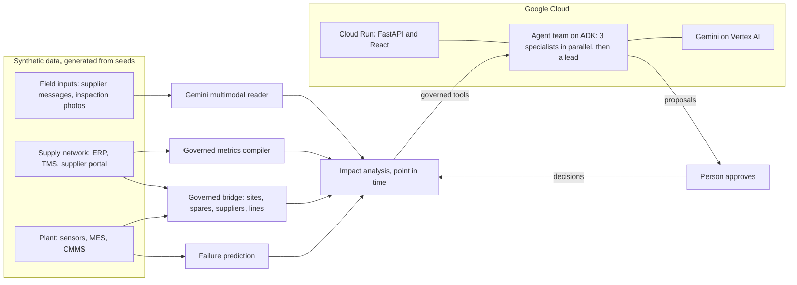

# OSI (Opsight Intelligence): submission write-up

AI Builder Cup 2026, Manufacturing track: Intelligent Operations and Industrial Efficiency.
This write-up follows the five points the organisers ask every submission to show.
Every number in it comes from the running app or its tests, and the command that reproduces it is named.

## 1. The problem and why it matters

A predictive maintenance alert only helps if the repair can happen before the failure. Whether it can depends on
information that lives in other departments:
- **Stores:** is the spare on the shelf, or already promised to another machine?
- **Purchasing:** when will the open order really arrive, given how this supplier has been delivering?
- **Customer service:** which customer orders does this line make in the next few days?

Answering that takes hours of calls, while the warning window (the P-F interval) runs out. Most AI tools answer one
department's question. The expensive mistakes happen between departments.

## 2. How the solution addresses it

OSI runs a sense, reason, act loop over governed data from a plant and its supply network, and closes it:

1. **Sense.** A gradient-boosted failure model scores every asset from its sensors. On the last four months of data it
   caught 27 of 41 failures, at 0.16 false alerts per asset-month and a median warning of 86 hours (`make models`).
2. **Reason.** A team of Gemini agents investigates each alert with governed tools. The team looks at sensor
   evidence, inspection photos, spare stock at both sites and the queue of alerts waiting for it, the supplier's
   governed on-time delivery, and the customer order lines at risk. Every way of getting the spare is priced as extra
   spend plus lost contribution.
3. **Act.** The team proposes the work order, the parts action, and the customer note. A person approves, and the
   approval changes the world: a transfer leaves the sister site's shelf, conflicts clear, and once the clock passes
   the failure, the outcome is shown against what would have happened without the plan.

**It runs on its own.** In live mode the plant is replayed as it happens. Each new alert pauses the clock while the
agents triage it and leave a proposal, so at 2 a.m. the plan is ready before anyone arrives.

**The demo moment (2026-07-25 02:00).**
- Two spindle-bearing alerts at site US1 need the one bearing set on the shelf.
- The replacement was ordered from supplier V10001, which was on time for 66.1% of its lines in the last 90 days, and
  whose delay notice Gemini reads from the supplier inbox (new date: 8 August).
- The copilot gives the set to the overdue alert and covers the other with an air transfer from site DE1 for 650 USD.
- Waiting for the open order would mean 190 hours of downtime and four customer order lines at risk.
- After approval, the spindle fails as predicted the next morning. With the transfer the line is down 26 hours instead
  of 230, saving 100,077 USD.

**The track record (`make value`).** Every alert of the last four months was scored at its real outcome, comparing
the copilot's plan with what the site would have done alone. The plan differed six times: three air transfers on real
failures saved 662 hours and 199,809 USD, and three express buys on alerts that turned out false cost 1,860 USD.
Net value: **197,949 USD in four months**, with the losses counted, not hidden.

## 3. How Google AI is integrated

- **A multi-agent team on the Agent Development Kit** (`src/backend/copilot/services/agent_team.py`).
  - A `ParallelAgent` runs a maintenance planner, a procurement lead, and a customer service lead at once, each with
    only its role's tools and a brief in session state.
  - A `SequentialAgent` then hands the briefs to an operations lead, who balances urgency, cost, and customer exposure,
    and proposes.
  - Free questions go to a single `LlmAgent` with all nine typed tools.
- **Streaming and transparency.** Every tool call, result, and brief streams to the browser with the agent's name, so
  people watch the team work rather than wait for a spinner.
- **Multimodal Gemini** (`src/backend/llm_gateway/multimodal.py`).
  - Gemini reads suppliers' messages, text or PDF, into delivery updates that follow a strict JSON schema. A new date
    revises the open order in every later analysis, and a price-list letter is read as "no delivery change", with no
    invented order.
  - Gemini vision reads a technician's inspection photo against the predicted failure mode, so a person sees whether
    the part confirms the prediction before money is spent.
- **Guardrails around the models.**
  - No SQL from the model: supplier figures come from a governed metric compiler and carry a SQL fingerprint.
  - Every number in an answer is checked against the tool results before the answer is marked verified.
  - Actions are proposals only, and their numbers come from the analysis, not from the model's text.
  - Every tool is point-in-time.
- **Resilience.** Backup Gemini models take over when one is out of quota. Errors reach people in plain words, and the
  autopilot stops itself instead of failing repeatedly.
- **Evaluation.** `make eval` runs eight scenarios, from triage to creating a proposal, and scores the tools called,
  the required facts, the number check, and the proposal.
- On Google Cloud, Gemini runs on **Vertex AI** under the Cloud Run service account, so no API key is deployed.

## 4. A functional prototype

- `make setup data models`, then `make api` and `make web`, builds everything from seeds and opens the app.
- The React frontend (Vite, TypeScript) talks to a FastAPI backend and has seven pages: Live, Control room, Copilot,
  Supplier inbox, Approvals, Track record, and How it works. The pages are described in `README.md`.
- Quality: 423 backend and 7 frontend automated tests, a code-rule checker, strict TypeScript, and offline tests of
  the real ADK runner and the agent team with scripted models.

## 5. Deployment on Google Cloud

- One container (`Dockerfile`). A Node stage builds the React app; the Python stage generates all data at build time;
  uvicorn serves the API, the agent stream, and the app on **Cloud Run**. One service, one URL, and the stream is
  never buffered.
- `deploy/cloudrun.sh` enables the APIs, creates a service account allowed only to call Vertex AI, and deploys from
  source with Cloud Build.
- `docs/HANDOVER.md` lists every step with checks, costs, and teardown.

## Architecture

## Honest limits

- The data is synthetic: a two-site plant and a four-plant supply network simulated from seeds, with no real company data.
- The spares store is simulated from the plant's own repairs and each supplier's delivery record; costs and
  contribution per unit are declared assumptions in `semantic/bridge/bridge.yaml`.
- The track record scores each alert independently.
- Approvals and field inputs are stored in the container and reset when it restarts; Firestore is the next step.
- The full evaluation on Gemini needs more quota than the free tier gives; single runs are verified.
