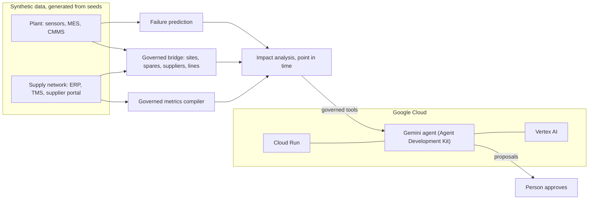

# emoldinounited: submission write-up

AI Builder Cup 2026, Manufacturing track: Intelligent Operations and Industrial Efficiency.
This write-up follows the five points the organisers ask every submission to show.
Every number in it comes from the running app or its tests, and the command that reproduces it is named.

## 1. The problem and why it matters

A predictive maintenance alert only helps if the repair can happen before the failure. Whether it can depends on
information that lives in other departments:
- **Stores:** is the spare on the shelf, or already promised to another machine?
- **Purchasing:** when will the open order really arrive, given how this supplier has been delivering?
- **Customer service:** which customer orders does this line make in the next few days?

Answering that takes hours of calls, while the warning window (the P-F interval) runs out. Most AI tools answer one
department's question. The expensive mistakes happen between departments.

## 2. How the solution addresses it

emoldinounited runs a sense, reason, act loop over governed data from the plant and the supply network:

1. **Sense.** A gradient-boosted failure model scores every asset from its sensors. On the last four months of data it
   caught 27 of 41 failures, at 0.16 false alerts per asset-month and a median warning of 86 hours (`make models`).
2. **Reason.** A Gemini agent investigates each alert with governed tools: sensor evidence, spare stock at both sites and
   the queue of alerts waiting for it, the supplier's on-time delivery from the governed metric, and the customer order
   lines at risk. Each way of getting the spare is priced as extra spend plus lost contribution.
3. **Act.** The agent proposes the work order, the parts action, and the customer note. A person approves or rejects it.

**The demo moment (2026-07-25 02:00, `make impact A=AL-US1-L2-01-2026072502`).**
- Two spindle-bearing alerts at site US1 need the one bearing set on the shelf.
- The replacement was ordered from supplier V10001, which was on time for 66.1% of its lines in the last 90 days.
- The copilot gives the set to the overdue alert and covers the other with an air transfer from site DE1 for 650 USD.
- Waiting for the open order would mean 190 hours of downtime, 93,825 USD of lost contribution, and four customer
  order lines at risk.
- Across the open alerts, the plan avoids 180 hours of downtime and 93,175 USD, shown in the control room.

## 3. How Google AI is integrated

- **Gemini** is the reasoning model, called through the **Agent Development Kit** (`src/backend/copilot/services/agent_runner.py`)
  as an `LlmAgent` with eight typed function tools (`agent_functions.py`).
- The agent decides which tools to call and in what order. For example, it analyses both competing alerts in parallel
  before recommending an allocation.
- **Guardrails around the model.** It never writes SQL; supplier figures come from a governed metric compiler and carry
  a SQL fingerprint. Every number in its answer is checked against the tool results before the answer is marked
  verified. Actions only become proposals, and their numbers come from the analysis, not from the model's text.
- On Google Cloud, Gemini runs on **Vertex AI** under the Cloud Run service account, so no API key is deployed.
- The agent is evaluated: `make eval` runs eight scenarios, from triage to creating a proposal, and scores the tools
  called, required facts, the number check, and the proposal.

## 4. A functional prototype

- `make setup data models app` builds everything from seeds in about a minute and opens the web app.
- **Control room:** the headline savings, then per alert the spare conflict, the supplier record, the priced options,
  the customers at risk, and the sensor evidence. One button asks the agent to draft the plan.
- **Ask the copilot:** free questions, with a verified badge and the full tool trace.
- **Approvals:** approve or reject proposals.
- **How it works:** the loop, the architecture, and the guardrails.
- Quality: 395 automated tests, a code-rule checker, and point-in-time tools, so no answer uses information from after
  the demo clock.

## 5. Deployment on Google Cloud

- One container (`Dockerfile`) generates all data at build time and serves the app on **Cloud Run**.
- `deploy/cloudrun.sh` enables the APIs, creates a service account allowed only to call Vertex AI, and deploys from
  source with Cloud Build.
- `docs/HANDOVER.md` lists every step with checks, costs, and teardown.

## Architecture

## Honest limits

- The data is synthetic: a two-site plant and a four-plant supply network simulated from seeds, with no real company data.
- The spares store is simulated from the plant's own repairs and each supplier's delivery record; costs and
  contribution per unit are declared assumptions in `semantic/bridge/bridge.yaml`.
- Approvals are stored in the container and reset when it restarts.
